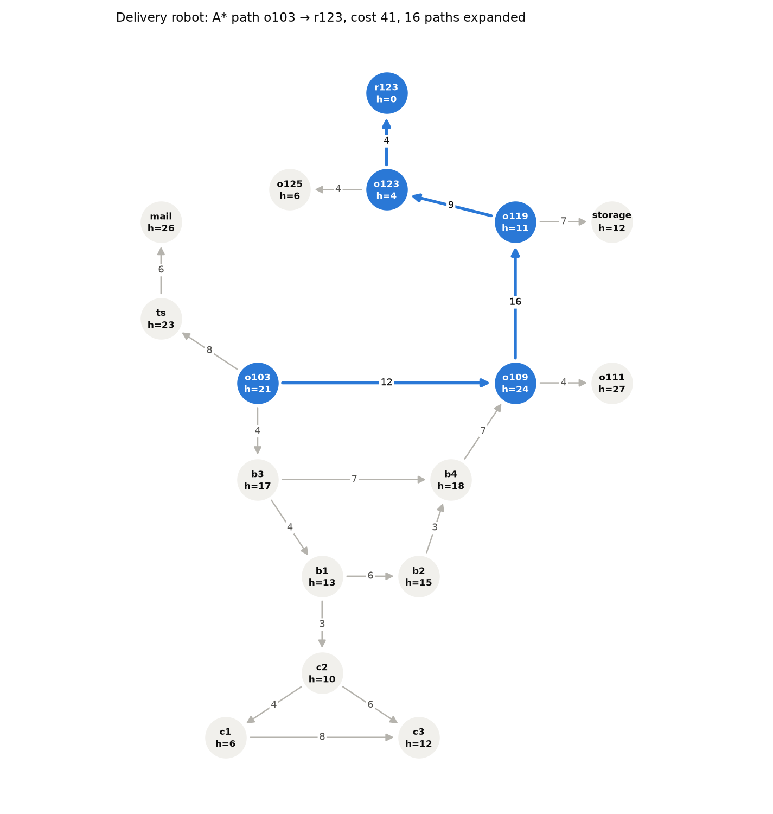
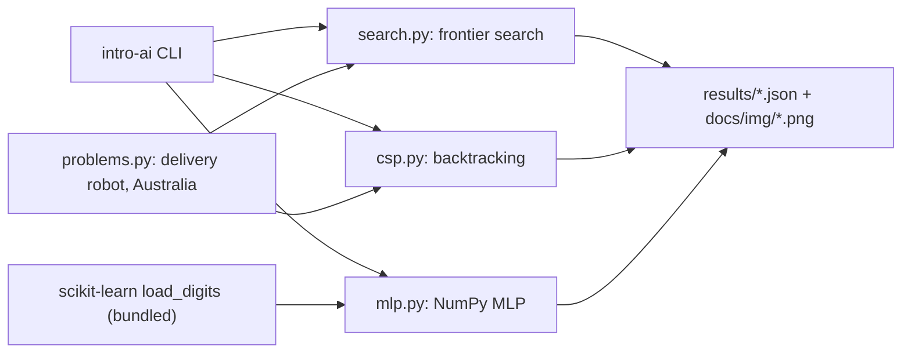
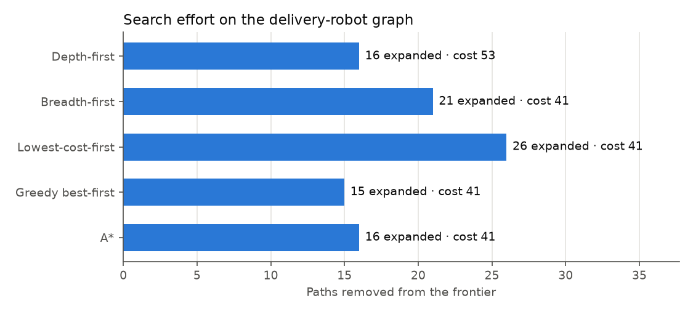
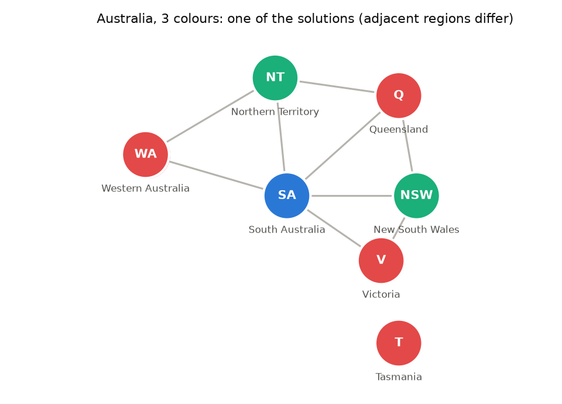
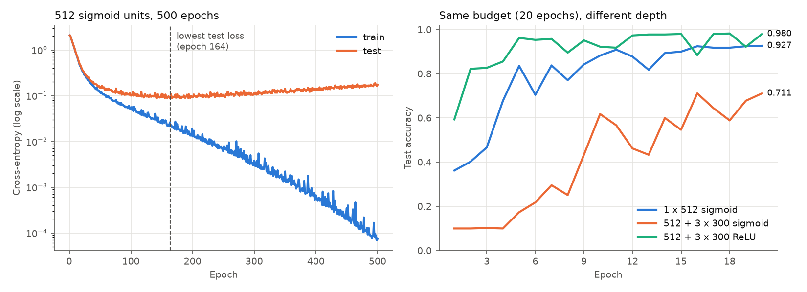

# Intro to AI from First Principles

Uninformed and heuristic graph search, backtracking for constraint satisfaction, and a multilayer perceptron trained with hand-written backpropagation, each checked against an independent reference.

[](https://github.com/gcfialho/uerj-intro-ai/actions/workflows/ci.yml)  [](LICENSE)



## Highlights

- **One search loop, five strategies.** Depth-first, breadth-first, lowest-cost-first, greedy best-first and A* share one frontier search. They differ only in which path leaves the frontier next. Cycle pruning is always on, and multiple-path pruning is optional.
- **Optimality checked, not assumed.** A reverse Dijkstra computes the exact cost-to-goal $h^*$ of every node. The tests use it to confirm that lowest-cost-first and A* return the optimum. A checker uses it to prove that the course heuristic is admissible and consistent.
- **A silent bug found and measured.** In the original code, the heuristic method was named `heuristic` but the searchers called `heuristica`, which fell back to a stub returning 0. "A*" therefore ran as lowest-cost-first (25 paths expanded instead of 16), and "greedy" ran uninformed and returned a path costing 53 instead of 41.
- **CSP solver with MRV and forward checking.** It enumerates all 18 colourings of Australia, cross-checked by brute force. On 20 random graph 3-colouring instances, MRV settles every instance, with a median of 91.5 assignments. Plain backtracking settles only 7 of the 20 within a 200,000-assignment budget.
- **Backpropagation from scratch.** A NumPy MLP whose gradients match finite differences to 1e-4 (relative). It uses RMSprop, and the experiments are reproducible from a seed. The experiments from the course notebook were redone correctly: a fresh model per run, with test accuracy measured.
- **Packaged and tested.** uv project, src layout, an `intro-ai` CLI, ruff, 77 pytest tests, and GitHub Actions on Python 3.12 and 3.13.

## Quickstart

Requires [uv](https://docs.astral.sh/uv/), which installs Python 3.12 and all dependencies from `uv.lock`. Everything runs offline.

```bash
git clone https://github.com/gcfialho/uerj-intro-ai.git
cd uerj-intro-ai
uv sync

uv run intro-ai search                 # five strategies on the delivery-robot graph
uv run intro-ai search --tie-break lifo
uv run intro-ai csp                    # Australia + random graph-colouring benchmark
uv run intro-ai mlp                    # five MLP experiments on 8x8 digits (~10 s)
uv run intro-ai all                    # everything: results/*.json and docs/img/*.png
```

Add `--no-files` to only print, or `--results-dir` / `--img-dir` to write elsewhere.

## How it works

| Module | What it does |
| --- | --- |
| `search.py` | `GraphProblem`, `Path`, `search(problem, strategy)`, `cost_to_goal` (reverse Dijkstra), `check_heuristic` (admissibility and consistency) |
| `csp.py` | `CSP` with binary not-equal constraints, `solve(...)` with MRV, forward checking, an assignment budget and counters; `random_graph_colouring` |
| `mlp.py` | Dense layers, sigmoid/ReLU, softmax + cross-entropy, backpropagation, RMSprop, training loop, experiment runner |
| `problems.py` | The delivery-robot graph with its heuristic, and the Australia map-colouring CSP |
| `plots.py`, `cli.py` | The README figures and the `intro-ai search \| csp \| mlp \| all` command |



## Results

Measured with `uv run intro-ai all` on Python 3.12.12, NumPy 2.5.4, scikit-learn 1.9.1 and Matplotlib 3.11.2. The raw output is in [`results/`](results/).

### Graph search

Delivery robot, from `o103` to `r123`. The optimal cost is 41. "Expanded" counts the paths removed from the frontier, including the one that reaches the goal. Ties are broken first in, first out.

| Strategy | Path found | Cost | Expanded (cycle pruning) | Expanded (multiple-path pruning) |
| --- | --- | ---: | ---: | ---: |
| Depth-first | o103 → b3 → b1 → b2 → b4 → o109 → o119 → o123 → r123 | 53 | 16 | 15 |
| Breadth-first | o103 → o109 → o119 → o123 → r123 | 41 | 21 | 17 |
| Lowest-cost-first | o103 → o109 → o119 → o123 → r123 | 41 | 26 | 17 |
| Greedy best-first | o103 → o109 → o119 → o123 → r123 | 41 | 15 | 13 |
| A* | o103 → o109 → o119 → o123 → r123 | 41 | 16 | 14 |

- **The heuristic is admissible and consistent,** but loose: $h(\text{o103}) = 21$ against a true cost of $h^*(\text{o103}) = 41$. It still saves A* 10 of the 26 expansions that lowest-cost-first needs.
- **Greedy best-first is only lucky here.** With last-in-first-out tie-breaking, which is what the original list-sort frontier did, it takes `o103 → b3 → b4 → o109 → …` for a cost of 47 (`--tie-break lifo`). A* returns 41 under either rule.
- **Effect of the original naming bug.** These figures come from running the 2023 scripts from git history; the "fixed" column renames the method and changes nothing else:

  | Original script | As submitted (h ≡ 0) | With the method renamed |
  | --- | --- | --- |
  | `BuscaAStar.py` | cost 41, 25 paths expanded | cost 41, 16 paths expanded |
  | `BuscaHeuristica.py` (greedy) | cost 53, 16 paths expanded | cost 47, 15 paths expanded |



### Constraint satisfaction

**Australia with 3 colours, all solutions.** Every configuration finds the same 18 colourings: South Australia has 3 choices, the ring around it must alternate the other two (2 ways), and Tasmania is free (3 choices). With the declared variable order, none of the 51 assignments has to be undone, so MRV changes nothing on this instance. Forward checking spends 174 constraint checks instead of 129. With 2 colours there is no solution.

**Random graph 3-colouring.** 20 Erdős–Rényi graphs $G(40,\,p = 4/39)$ (mean degree 4, near the 3-colourability threshold), seeds 0–19. Each run stops at the first solution, or after a budget of 200,000 assignments:

| Solver | Settled within budget | Satisfiable | Proved unsatisfiable | Median assignments | Max. assignments |
| --- | ---: | ---: | ---: | ---: | ---: |
| Plain backtracking | 7 / 20 | 7 | 0 | 200,000 (budget) | 200,000 |
| Forward checking | 16 / 20 | 12 | 4 | 14,478.5 | 200,000 |
| MRV | 20 / 20 | 13 | 7 | 91.5 | 6,717 |
| MRV + forward checking | 20 / 20 | 13 | 7 | 91.5 | 6,717 |

MRV and MRV + forward checking make the same number of assignments. Both detect the same dead ends: MRV picks a variable with no legal value left and fails at once, while forward checking rejects the assignment that would empty a domain.



### Multilayer perceptron

scikit-learn's 8x8 digits (1,797 images, pixels scaled to [0, 1]), with a stratified 75/25 split: 1,347 training and 450 test images. Training uses RMSprop with learning rate $10^{-3}$, batch size 128, Glorot-uniform initialisation and seed 0. Each row trains a fresh model.

| Experiment | Hidden layers | Epochs | Parameters | Train acc. | Test acc. | Test loss |
| --- | --- | ---: | ---: | ---: | ---: | ---: |
| Baseline (notebook model) | 512 sigmoid | 20 | 38,410 | 0.932 | 0.927 | 0.398 |
| Fewer epochs | 512 sigmoid | 2 | 38,410 | 0.382 | 0.402 | 1.977 |
| Many epochs | 512 sigmoid | 500 | 38,410 | 1.000 | 0.962 | 0.172 |
| Deeper, sigmoid | 512, 300, 300, 300 sigmoid | 20 | 370,790 | 0.744 | 0.711 | 0.842 |
| Deeper, ReLU | 512, 300, 300, 300 ReLU | 20 | 370,790 | 1.000 | 0.980 | 0.050 |

- **Overfitting with long training.** In the 500-epoch run the training loss keeps falling, to $10^{-4}$. The test loss bottoms out at 0.087 in epoch 164 and then roughly doubles. Test accuracy peaks at 0.982 (epoch 155) and ends at 0.962. These peaks are read off the test curve, so they describe the run; they are not a tuned result.
- **Depth alone does not help.** With the same 20-epoch budget, three extra sigmoid layers lower test accuracy from 0.927 to 0.711, most likely because the saturating sigmoid units slow gradient flow. The same architecture with ReLU reaches 0.980.



## Methodology

### Search

A path $p$ from the start node has cost $g(p)$, the sum of its arc costs. Each strategy removes the next path from the frontier by a different rule:

| Strategy | Next path removed from the frontier |
| --- | --- |
| Depth-first | the most recently added |
| Breadth-first | the least recently added |
| Lowest-cost-first | the one with minimum $g(p)$ |
| Greedy best-first | the one with minimum $h(\text{end}(p))$ |
| A* | the one with minimum $f(p) = g(p) + h(\text{end}(p))$ |

- **Goal test.** It is applied when a path is removed from the frontier, not when it is added. That is what makes lowest-cost-first and A* optimal.
- **Pruning.** Cycle pruning never extends a path to a node it already contains. Multiple-path pruning expands each node at most once. With a consistent heuristic, A* stays optimal under it.
- **Heuristic checks.** Running Dijkstra on the reversed arcs gives the true cost $h^*(n)$ from each node to the goal. The heuristic is *admissible* if $h(n) \le h^*(n)$ for every node, and *consistent* if $h(u) \le c(u,v) + h(v)$ for every arc and $h = 0$ at the goals.

The delivery-robot domain (an office floor with rooms `o103`, `r123`, the mail room, `storage` and so on) is the running example of D. L. Poole and A. K. Mackworth, *Artificial Intelligence: Foundations of Computational Agents* (Cambridge University Press), chapter 3. The arc costs and heuristic values are the ones used in the course assignment.

### Constraint satisfaction

Depth-first backtracking assigns one variable at a time and rejects a value that conflicts with an already assigned neighbour.

- **MRV** picks the unassigned variable with the fewest values that are still consistent with the current assignment, breaking ties by declaration order.
- **Forward checking** deletes the assigned value from the domains of unassigned neighbours, and backtracks as soon as one of those domains becomes empty.
- **Counters.** `assignments` counts values placed (search-tree nodes). `backtracks` counts assignments undone without leading to any solution. `checks` counts pairwise constraint tests.

### MLP

For hidden layers $a_\ell = \sigma(a_{\ell-1}W_\ell + b_\ell)$, with $\sigma$ the sigmoid or ReLU. The output layer is a softmax, and the loss is the mean categorical cross-entropy over a batch of $n$ examples.

- **Backward pass.** It starts from $\partial L / \partial z_L = (P - Y)/n$ and applies the chain rule layer by layer.
- **RMSprop.** It uses Keras' defaults: $s \leftarrow \rho s + (1-\rho) g^2$ and $\theta \leftarrow \theta - \eta\, g / (\sqrt{s} + \epsilon)$, with $\rho = 0.9$ and $\epsilon = 10^{-7}$.
- **Metrics.** Train and test loss and accuracy are recorded after every epoch.

### Fixes to the original coursework

1. **Heuristic never used.** The problem class defined `heuristic()`, but the searchers called `heuristica()`, which was inherited from a base class that returns 0. A* and greedy search therefore ran uninformed (see the table above).
2. **Network experiments built on each other.** The notebook trained a single Keras model throughout. The "fewer epochs" run (2 epochs, 99.9% training accuracy) actually continued from the 20-epoch model, and the 500-epoch run continued from that.
3. **Layers added after the output.** The "more layers" experiment appended three sigmoid layers and a second softmax *after* the existing softmax output. On the sample test image, the resulting network's highest class probability was 0.16.
4. **Test accuracy never reported.** Only training accuracy and single test images were reported, so the overfitting question the assignment asked about could not be answered. This rewrite records train and test metrics for every epoch.
5. **Smaller issues.** Searches had no pruning. The map-colouring script kept its state in globals and printed solutions instead of returning them.

## Project structure

```
.
├── pyproject.toml          # uv project, CLI entry point, ruff + pytest config
├── uv.lock
├── src/intro_ai/           # search, csp, mlp, problems, plots, cli
├── tests/                  # 77 tests: search, csp, mlp, cli
├── results/                # search.json, csp.json, mlp.json (per-epoch histories)
├── docs/img/               # README figures, regenerated by `intro-ai all`
└── .github/workflows/ci.yml
```

## Testing

```bash
uv run pytest                                        # 77 tests, ~2 s
uv run ruff check . && uv run ruff format --check .
```

The tests cover:

- **Search:**
  - every strategy returns a valid start-to-goal path whose cost is the sum of its arcs;
  - lowest-cost-first and A* match the Dijkstra optimum under both pruning modes and both tie-breaking rules;
  - breadth-first returns the fewest-arc path;
  - a constructed graph where greedy best-first is suboptimal and A* is not;
  - the heuristic checker flags known overestimating and inconsistent heuristics, and passes the course heuristic;
  - A* with $h \equiv 0$ expands exactly the same paths as lowest-cost-first;
  - cycles, unreachable goals and input validation.
- **CSP:**
  - the 18 Australian colourings equal a brute-force enumeration, under every solver configuration;
  - 2 colours are unsatisfiable;
  - small random graphs match brute force;
  - on five random 3-colouring instances, MRV needs at least 10 times fewer assignments than plain backtracking;
  - the budget and the symmetry validation.
- **MLP:**
  - analytic gradients match central finite differences for sigmoid and ReLU networks;
  - softmax is stable for large logits, and the cross-entropy values are correct;
  - the split is stratified;
  - a small network passes 90% test accuracy in 15 epochs;
  - training is deterministic for a seed, and every experiment starts from a fresh model.
- **CLI:** smoke runs that write the JSON results and figures.

## Limitations & roadmap

- The search problems are small explicit graphs. There is no implicit state-space interface, no iterative deepening (IDA*), and no bidirectional search.
- The CSP solver only handles binary not-equal constraints, which is enough for graph colouring. General constraints, arc consistency (AC-3) and the least-constraining-value ordering are natural next steps.
- The course notebook used MNIST (28x28, 60,000 training images) with Keras. This rewrite uses scikit-learn's bundled 8x8 digits instead, so it runs offline in seconds without TensorFlow. The accuracies are therefore not comparable with MNIST results.
- The MLP experiments use one seed and one train/test split, with no validation set and no early stopping or regularisation. Small differences between rows should not be over-read.

Coursework for the Artificial Intelligence course (Inteligência Artificial, 2023.1) of the Computer Engineering program at UERJ (Instituto Politécnico, IPRJ). The search code is an independent rewrite; the delivery-robot example is credited to Poole and Mackworth above.

## Author

Guilherme Fialho · Machine Learning Engineer (GenAI/LLMs) and Data Engineer · [LinkedIn](https://www.linkedin.com/in/guilherme-cagide-fialho/) · [GitHub](https://github.com/gcfialho)

Released under the [MIT License](LICENSE).
